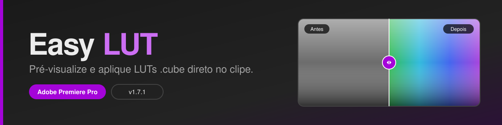
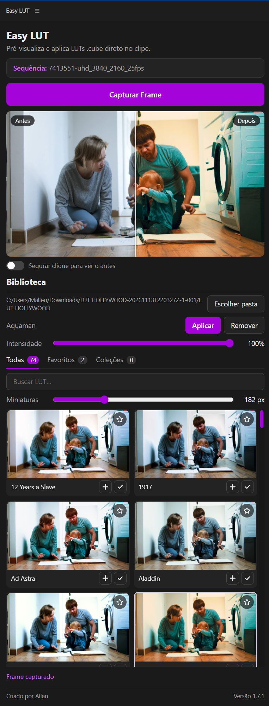
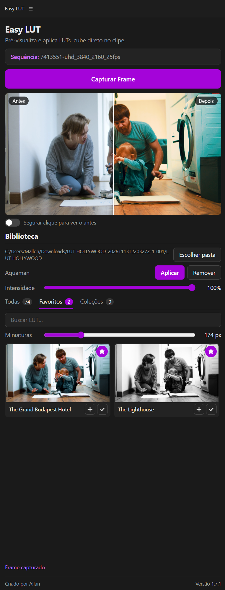
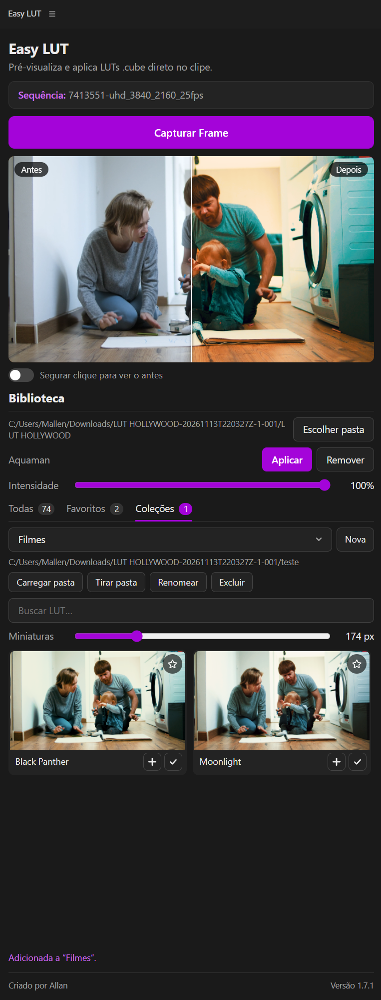
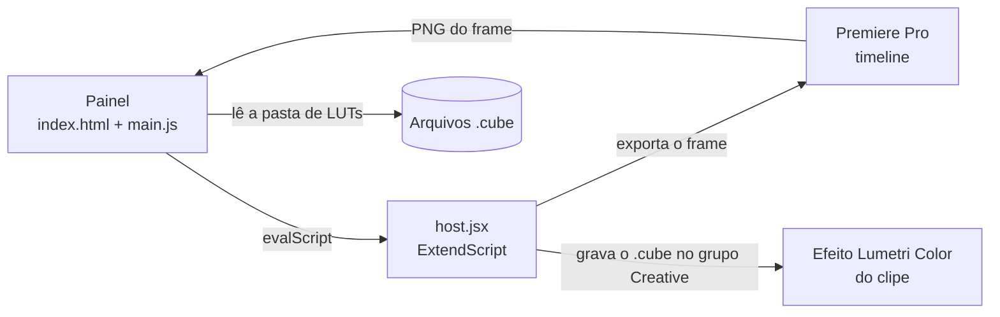
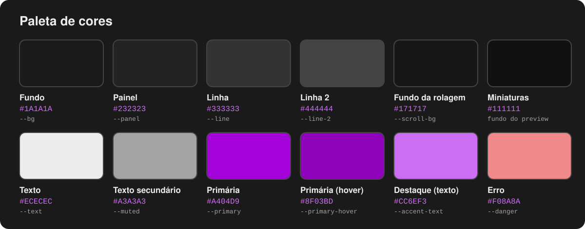

<div align="center">



<br>


**Painel para o Adobe Premiere Pro que mostra como cada LUT `.cube` ficaria no seu frame e aplica a escolhida direto no clipe, com um clique.**

[Baixar o instalador](../../releases/latest) ·
[Instalação](#instalação) ·
[Funcionalidades](#funcionalidades) ·
[Como usar](#como-usar) ·
[Paleta de cores](#paleta-de-cores) ·
[Problemas comuns](#solução-de-problemas)

</div>

---

## Sumário

- [Sobre](#sobre)
- [Funcionalidades](#funcionalidades)
- [Requisitos](#requisitos)
- [Instalação](#instalação)
  - [Opção 1 — Instalador (recomendado)](#opção-1--instalador-recomendado)
  - [Opção 2 — Instalação manual (copiar e colar)](#opção-2--instalação-manual-copiar-e-colar)
  - [Atualizar](#atualizar-para-uma-nova-versão)
  - [Desinstalar](#desinstalar)
- [Como usar](#como-usar)
- [Como funciona por dentro](#como-funciona-por-dentro)
- [Paleta de cores](#paleta-de-cores)
- [Estrutura do repositório](#estrutura-do-repositório)
- [Solução de problemas](#solução-de-problemas)
- [Limitações conhecidas](#limitações-conhecidas)
- [Contribuindo](#contribuindo)
- [Licença](#licença)

---

## Sobre

Testar LUTs no Premiere costuma ser lento: aplicar uma, olhar, trocar o arquivo no Lumetri, olhar de novo. O **Easy LUT** resolve isso com um painel que:

1. captura o frame atual da sua timeline;
2. gera uma miniatura **de cada LUT da sua biblioteca sobre esse frame**, para você comparar tudo de uma vez;
3. aplica a LUT escolhida no clipe (no grupo **Creative** do efeito Lumetri Color), com controle de intensidade.

<div align="center">



<br>
<sub>Interface do painel Easy LUT.</sub>
</div>

---

## Funcionalidades

### Pré-visualização

| Recurso | O que faz |
| --- | --- |
| **Captura de frame** | O botão **Capturar Frame** exporta o frame sob o cursor da timeline e usa essa imagem como base de todas as miniaturas e do preview grande. O painel também captura um frame sozinho ao abrir. |
| **Comparador Antes / Depois** | O preview tem um divisor que você arrasta para a esquerda e para a direita, com os rótulos *Antes* e *Depois*. |
| **Modo "Segurar clique"** | Com a chave **Segurar clique para ver o antes** ligada, segurar o botão do mouse sobre o preview mostra o original, e soltar mostra a LUT selecionada. |
| **Miniaturas ao vivo** | Cada LUT da biblioteca aparece como uma miniatura renderizada sobre o seu frame. Elas são desenhadas aos poucos, só as que estão visíveis, para o painel não travar. |
| **Tamanho das miniaturas** | Um controle deslizante ajusta o tamanho de 130 a 320 px. Em painéis estreitos a grade vira uma coluna, sem estourar a largura. |
| **Intensidade no preview** | O controle de intensidade (0 a 100%) também vale para o preview, então você enxerga o resultado antes de aplicar. |

### Aplicação no Premiere

| Recurso | O que faz |
| --- | --- |
| **Aplicar em um ou vários clipes** | A LUT vai para os clipes de **vídeo selecionados**. Sem seleção, vai para o clipe que está sob o cursor, na trilha de vídeo mais alta. |
| **Lumetri automático** | Se o clipe ainda não tem o efeito Lumetri Color, o painel adiciona. A LUT é gravada no grupo **Creative**, e o painel não cria camadas de ajuste. |
| **Intensidade em tempo real** | Mexer no controle de intensidade atualiza a intensidade da LUT nos clipes alvo, sem precisar aplicar de novo. |
| **Remover LUT** | O botão **Remover** limpa a LUT do clipe e desliga o campo no Lumetri. |
| **LUT ativa em destaque** | A miniatura da LUT que está aplicada no clipe ganha uma borda roxa com brilho. O painel confere o clipe a cada poucos segundos e quando ganha foco. |
| **Nome da sequência** | A sequência ativa aparece no topo do painel. |
| **Cópia segura do arquivo** | Antes de aplicar, o `.cube` é copiado para uma pasta própria com nome simples, sem acentos nem símbolos, para o Premiere não ter problema com caminhos difíceis. O arquivo original não é alterado. |

### Biblioteca

| Recurso | O que faz |
| --- | --- |
| **Pasta de LUTs** | Você escolhe uma pasta e o painel lê todos os `.cube` dela, **incluindo subpastas**. A pasta fica lembrada para a próxima vez. |
| **Categorias automáticas** | Cada subpasta vira uma categoria, e você filtra por ela no seletor ao lado da busca. |
| **Busca** | Filtra as LUTs pelo nome enquanto você digita. |
| **Favoritos** | A estrela em cada miniatura guarda a LUT na aba **Favoritos**. Os favoritos valem para qualquer pasta. |
| **Coleções** | Agrupe LUTs do seu jeito. Uma coleção pode ter uma **pasta própria** e também LUTs adicionadas à mão pelo botão **+** de cada miniatura. Dá para criar, renomear, excluir, carregar e tirar a pasta de uma coleção. Excluir uma coleção **não apaga** nenhum arquivo. |
| **Aviso de arquivo ausente** | Se uma LUT favorita ou de coleção foi movida ou apagada, o nome fica em vermelho e o painel avisa ao tentar aplicar. |

### Interface

- Tema escuro com a [paleta própria do projeto](#paleta-de-cores).
- Seletores e menus próprios, no lugar dos nativos do Windows, com navegação pelo teclado (setas e `Esc`).
- Janelas de nome e de confirmação do próprio painel, porque o `prompt()` do navegador não funciona dentro de painéis do Premiere.
- Barra de rolagem fina e arredondada, na cor do tema.
- Painel redimensionável: abre em 420 × 680 px e vai até 300 × 400 px.
- Foco visível nos botões e campos, para quem navega pelo teclado.

---

## Requisitos

| Item | Requisito |
| --- | --- |
| Programa | Adobe Premiere Pro **2020 (versão 14.0) ou mais novo** |
| Sistema | Windows 10 ou 11 |
| LUTs | Arquivos **`.cube` 3D** (veja as [limitações](#limitações-conhecidas)) |
| Instalação | Não precisa de conta de administrador (veja abaixo) |

> O Easy LUT é uma extensão CEP. A Adobe vem migrando seus painéis para uma tecnologia nova (UXP) e planeja deixar o CEP para trás no futuro. Se uma versão futura do Premiere deixar de carregar painéis CEP, o Easy LUT deixa de aparecer nela. Documentação do CEP: [Adobe-CEP no GitHub](https://github.com/Adobe-CEP).

---

## Instalação

Escolha **uma** das opções. As duas deixam a extensão no mesmo lugar e fazem a mesma coisa.

### Opção 1 — Instalador (recomendado)

1. Abra a página de [**Releases**](../../releases/latest) e baixe o arquivo `EasyLUT-Setup-1.7.1.exe` (o número muda a cada versão).
2. **Feche o Premiere Pro.**
3. Dê dois cliques no `.exe`.
   - Se o Windows mostrar a tela azul **"O Windows protegeu o computador"**, clique em **Mais informações** e depois em **Executar assim mesmo**. Isso acontece porque o instalador não tem assinatura digital paga.
4. Se o Windows perguntar, escolha instalar **só para você** (não pede administrador) ou **para todos os usuários** (pede administrador).
5. Siga o assistente, que está em português. Ele sugere a pasta certa. Mantenha a sugestão, porque o Premiere só encontra extensões dentro de uma pasta `CEP\extensions`.
6. Clique em **Instalar** e depois em **Concluir**.
7. Abra o Premiere e vá em **Janela › Extensões › Easy LUT** (em inglês: *Window › Extensions › Easy LUT*).

O instalador também libera o carregamento de extensões sem assinatura da Adobe, escrevendo o valor `PlayerDebugMode` no registro do seu usuário (veja o passo 2 da instalação manual).

| Instalação | Pasta de destino |
| --- | --- |
| Só para você (padrão) | `%APPDATA%\Adobe\CEP\extensions\EasyLUT` |
| Para todos os usuários (administrador) | `C:\Program Files (x86)\Common Files\Adobe\CEP\extensions\EasyLUT` |

### Opção 2 — Instalação manual (copiar e colar)

Para quem prefere não rodar o instalador, ou quer controlar cada passo. Não precisa de nenhum script. São dois passos: **copiar a pasta** e **liberar o painel no registro**.

#### Passo 1 — Baixe e copie a pasta `EasyLUT`

1. Baixe os arquivos do projeto. Você tem duas formas:
   - na página de [**Releases**](../../releases/latest), baixe o `EasyLUT-1.7.1-manual.zip` (traz só a extensão); ou
   - neste repositório, clique em **Code › Download ZIP**.
2. Extraia o ZIP. Você vai ver uma pasta chamada **`EasyLUT`**, com estas subpastas dentro:

   ```text
   EasyLUT
   ├── CSXS
   │   └── manifest.xml
   ├── css
   ├── js
   ├── jsx
   └── index.html
   ```

3. Abra o Explorador de Arquivos e cole este endereço na barra de endereço, depois pressione `Enter`:

   ```text
   %APPDATA%\Adobe\CEP\extensions
   ```

   Se a pasta `CEP` ou a pasta `extensions` não existir, crie as duas.
4. **Copie a pasta `EasyLUT` inteira** para dentro de `extensions`.
5. Confira o resultado. O arquivo `manifest.xml` tem que ficar exatamente neste caminho:

   ```text
   %APPDATA%\Adobe\CEP\extensions\EasyLUT\CSXS\manifest.xml
   ```

   > **Erro comum:** colar a pasta duas vezes e acabar com `EasyLUT\EasyLUT\CSXS\...`. Nesse caso o painel não aparece. Mova o conteúdo para o nível certo.

> Quer instalar para todos os usuários do computador? Copie a pasta para `C:\Program Files (x86)\Common Files\Adobe\CEP\extensions` (o Windows pede permissão de administrador). O passo 2 vale por usuário, então cada pessoa faz o seu.

#### Passo 2 — Libere extensões sem assinatura no registro

O Premiere só carrega painéis sem assinatura digital da Adobe se o modo de depuração estiver ligado. Isso é um valor de texto chamado `PlayerDebugMode`, com o conteúdo `1`.

**Pelo Editor do Registro:**

1. Pressione `Win + R`, digite `regedit` e pressione `Enter`.
2. Vá até `HKEY_CURRENT_USER\Software\Adobe`.
3. Dentro de `Adobe`, procure as chaves `CSXS.9`, `CSXS.10`, `CSXS.11`, `CSXS.12` e `CSXS.13`. Se alguma não existir, crie: clique com o botão direito em `Adobe` › **Novo** › **Chave** e dê o nome.
4. Dentro de **cada uma** dessas chaves, clique com o botão direito no espaço vazio › **Novo** › **Valor da cadeia de caracteres** (*String Value*).
5. Dê o nome **`PlayerDebugMode`**, dê dois cliques nele e coloque **`1`** em *Dados do valor*.

> Fazer nas cinco chaves garante que funciona em qualquer versão do Premiere que use o Easy LUT. Cada versão do Premiere lê a chave da sua própria geração do CEP, por isso são várias.

**Ou, pelo Prompt de Comando** (opcional, é o mesmo resultado):

```bat
for %v in (9 10 11 12 13) do reg add HKCU\Software\Adobe\CSXS.%v /v PlayerDebugMode /t REG_SZ /d 1 /f
```

#### Passo 3 — Abra o painel

1. **Feche o Premiere por completo** e abra de novo.
2. Vá em **Janela › Extensões › Easy LUT**.

Se o painel não aparecer, veja a [solução de problemas](#solução-de-problemas).

### Atualizar para uma nova versão

- **Com o instalador:** feche o Premiere e rode o instalador novo. Ele apaga a versão anterior da pasta e instala a nova.
- **Manualmente:** feche o Premiere, apague a pasta `EasyLUT` antiga, copie a nova no lugar e abra o Premiere. O registro não precisa ser refeito.

Os arquivos `.cube` não são tocados. Favoritos e coleções ficam guardados fora da pasta da extensão (no armazenamento do painel) e normalmente continuam depois de atualizar.

### Desinstalar

- **Instalado pelo instalador:** *Configurações › Aplicativos › Easy LUT para Premiere › Desinstalar*.
- **Instalado manualmente:** feche o Premiere e apague a pasta `EasyLUT` de dentro de `CEP\extensions`.

O valor `PlayerDebugMode` do registro **não é removido**, porque outras extensões que você use podem depender dele. As cópias de LUTs que o painel guarda em `%APPDATA%\EasyLUT\staged` também continuam lá, e você pode apagar essa pasta se quiser.

---

## Como usar

1. **Abra uma sequência** no Premiere e deixe o cursor sobre uma imagem representativa do vídeo.
2. Abra o painel em **Janela › Extensões › Easy LUT**.
3. Clique em **Escolher pasta** e selecione a pasta onde estão seus arquivos `.cube`. As miniaturas aparecem em seguida.
4. Clique em **Capturar Frame** sempre que quiser testar as LUTs em outra imagem. As miniaturas são redesenhadas sobre o novo frame.
5. **Compare:** clique numa miniatura para ver o preview grande. Arraste o divisor para comparar antes e depois, ou ligue **Segurar clique para ver o antes**.
6. **Ajuste a intensidade** no controle deslizante, de 0 a 100%.
7. **Selecione o clipe** na timeline e aplique a LUT:
   - clique em **Aplicar**, ou
   - clique no botão de **visto** que existe no rodapé de cada miniatura.
8. Para tirar a LUT do clipe, clique em **Remover**.

> **Dica:** o frame capturado inclui os efeitos que o clipe já tiver. Para ver as LUTs sobre a imagem original, use **Remover** no clipe antes de capturar o frame.

### Favoritos

Clique na **estrela** no canto da miniatura. As LUTs favoritas ficam na aba **Favoritos**, de qualquer pasta, e a contagem aparece ao lado do nome da aba.

### Coleções

1. Abra a aba **Coleções** e clique em **Nova** para criar uma coleção.
2. Preencha a coleção de duas formas, que podem ser combinadas:
   - **Carregar pasta:** todas as LUTs de uma pasta entram na coleção.
   - Botão **+** em qualquer miniatura: adiciona (ou remove) aquela LUT na coleção que você escolher. Também dá para criar uma coleção nova por esse menu.
3. Use **Renomear**, **Excluir** e **Tirar pasta** para organizar. Excluir uma coleção só remove o agrupamento: as LUTs e as pastas continuam no seu computador.

### Atalhos de teclado

| Tecla | Onde | Ação |
| --- | --- | --- |
| `↑` `↓` | Seletores abertos | Navegar entre as opções |
| `Esc` | Seletores, menu **+** e janelas | Fechar |
| `Enter` | Janela de nome ou confirmação | Confirmar |

---

## Como funciona por dentro

O Easy LUT é uma extensão **CEP**: uma página HTML, CSS e JavaScript que roda dentro de um painel do Premiere e conversa com o programa por um script em **ExtendScript**. Não há etapa de compilação.



- **Preview:** o painel lê o `.cube`, e aplica a LUT 3D ao frame com **interpolação trilinear**, dentro de um `canvas`. Tudo acontece localmente, sem enviar nada para fora. As LUTs lidas ficam em cache para não reler o arquivo toda hora.
- **Aplicação:** o `host.jsx` localiza o efeito Lumetri Color do clipe (e adiciona, se faltar), encontra o grupo **Creative** e preenche o caminho do `.cube`. Depois o painel confere se o Premiere guardou o caminho, lendo o valor de volta. O Premiere aceita o caminho em formatos um pouco diferentes, então o painel tenta algumas variantes até uma funcionar e lembra qual funcionou.
- **Idiomas do Premiere:** o grupo Creative é reconhecido pelo nome em português, inglês, espanhol, francês e alemão.
- **Dados guardados:** favoritos, coleções, pasta, tamanho das miniaturas e preferências ficam no armazenamento local do próprio painel. O painel não cria conta nem envia dados pela internet.

---

## Paleta de cores

A interface usa um tema escuro e um roxo como cor principal. Os valores estão como variáveis no início de [`EasyLUT/css/style.css`](EasyLUT/css/style.css).



| Função | Cor | Hex | Variável CSS |
| --- | --- | --- | --- |
| Fundo |  | `#1A1A1A` | `--bg` |
| Painel e cartões |  | `#232323` | `--panel` |
| Linhas e divisórias |  | `#333333` | `--line` |
| Bordas de botões |  | `#444444` | `--line-2` |
| Fundo da barra de rolagem |  | `#171717` | `--scroll-bg` |
| Texto principal |  | `#ECECEC` | `--text` |
| Texto secundário |  | `#A3A3A3` | `--muted` |
| **Cor principal** (botões, abas, destaques) |  | `#A404D9` | `--primary` |
| Principal ao passar o mouse |  | `#8F03BD` | `--primary-hover` |
| Destaque para texto sobre fundo escuro |  | `#CC6EF3` | `--accent-text` |
| Erro e avisos |  | `#F08A8A` | `--danger` |

**Contraste (WCAG):** texto branco sobre `#A404D9` tem **5,8:1** e sobre `#8F03BD` tem **7,2:1**. O `#CC6EF3` sobre o fundo `#1A1A1A` tem **5,9:1**. O texto `#ECECEC` sobre o fundo tem **14,7:1**. Todos passam do mínimo de 4,5:1 para texto normal.

O assistente do instalador usa as mesmas cores.

---

## Estrutura do repositório

```text
.
├── EasyLUT/                  # A extensão: é esta pasta que vai para o Premiere
│   ├── CSXS/
│   │   └── manifest.xml      # Identificação, versão e tamanho do painel
│   ├── css/
│   │   └── style.css         # Estilos e paleta de cores
│   ├── js/
│   │   └── main.js           # Lógica do painel (interface, .cube, favoritos, coleções)
│   ├── jsx/
│   │   └── host.jsx          # Script do Premiere (captura de frame, Lumetri)
│   └── index.html            # Estrutura do painel
├── docs/
│   ├── assets/               # Banner, paleta e captura de tela do README
│   └── PUBLICAR.md           # Guia para publicar uma versão e o instalador
├── .github/ISSUE_TEMPLATE/   # Modelo para relatar problemas
├── CHANGELOG.md
├── CONTRIBUTING.md
├── LICENSE
└── README.md
```

O instalador (`.exe`) **não fica neste repositório**. Ele é publicado na página de [Releases](../../releases).

---

## Solução de problemas

<details>
<summary><b>O painel não aparece em Janela › Extensões</b></summary>

<br>

1. Confira se o arquivo está em `%APPDATA%\Adobe\CEP\extensions\EasyLUT\CSXS\manifest.xml`, sem pasta `EasyLUT` repetida.
2. Confira o registro: em `HKEY_CURRENT_USER\Software\Adobe\CSXS.9` até `CSXS.13` deve existir o valor de texto `PlayerDebugMode` com o conteúdo `1`.
3. Feche o Premiere **por completo** (veja se não sobrou nenhum processo no Gerenciador de Tarefas) e abra de novo.
4. Confirme que o seu Premiere é a versão 2020 (14.0) ou mais nova.

</details>

<details>
<summary><b>"O script do Premiere (host.jsx) não carregou. Reinstale e reinicie o Premiere."</b></summary>

<br>

O painel abriu, mas o arquivo `jsx\host.jsx` não foi encontrado ou não carregou. Confira se a pasta `jsx` existe dentro de `EasyLUT` e reinicie o Premiere. Se continuar, reinstale.

</details>

<details>
<summary><b>"Abra uma sequência no Premiere" ou "Selecione um clipe de vídeo"</b></summary>

<br>

O painel trabalha sobre a sequência ativa. Abra uma sequência e selecione um clipe de **vídeo** na timeline, ou deixe o cursor sobre ele.

</details>

<details>
<summary><b>"Não deu para capturar o frame"</b></summary>

<br>

A captura depende de um recurso interno do Premiere que pode variar entre versões. Confira se há uma sequência aberta e se o cursor está sobre uma imagem, e tente de novo. Mesmo sem o frame capturado, o painel continua funcionando com uma imagem de teste, e a aplicação das LUTs no clipe não depende da captura.

</details>

<details>
<summary><b>"Nenhum arquivo .cube encontrado nessa pasta"</b></summary>

<br>

O painel procura arquivos com a extensão `.cube`, incluindo as subpastas. Se as suas LUTs estão em outro formato (`.3dl`, `.look`, `.lut`), converta para `.cube` antes.

</details>

<details>
<summary><b>A miniatura mostra "sem preview"</b></summary>

<br>

O arquivo é uma LUT **1D** ou está com defeito. O painel só desenha preview de LUTs `.cube` 3D válidas. Você ainda pode tentar aplicar a LUT no clipe.

</details>

<details>
<summary><b>"Grupo Creative não encontrado" ou "O Premiere não aceitou a LUT"</b></summary>

<br>

- O painel encontra o grupo Creative do Lumetri pelo nome. Ele reconhece português, inglês, espanhol, francês e alemão. Se o seu Premiere está em outro idioma, o grupo pode não ser encontrado.
- Confirme que o arquivo da LUT ainda existe no lugar. Se foi movido, o cartão aparece em vermelho.

</details>

<details>
<summary><b>O Windows bloqueou o instalador</b></summary>

<br>

Se aparecer a tela azul do SmartScreen, clique em **Mais informações** e depois em **Executar assim mesmo**. Se preferir não rodar o instalador, use a [instalação manual](#opção-2--instalação-manual-copiar-e-colar).

</details>

Não resolveu? [Abra uma issue](../../issues/new/choose) contando a versão do Premiere, a versão do Windows, como você instalou e a mensagem que apareceu no rodapé do painel.

---

## Limitações conhecidas

- **Só Windows.** O instalador e as instruções são para Windows. O macOS não tem suporte oficial.
- **Só LUTs `.cube` 3D** têm preview. LUTs 1D aparecem como "sem preview".
- **O preview é uma aproximação.** Ele é calculado pelo painel sobre uma imagem de 8 bits, e o Premiere aplica a LUT no pipeline de cor dele. Pequenas diferenças são esperadas, principalmente em projetos com gerenciamento de cor ou em formatos de alto alcance dinâmico.
- **Depende do CEP,** que a Adobe está substituindo gradualmente por UXP (veja os [requisitos](#requisitos)).
- **A captura de frame usa um recurso interno do Premiere** que não é documentado oficialmente e pode mudar entre versões.

---

## Contribuindo

Contribuições são bem-vindas. Leia o [guia de contribuição](CONTRIBUTING.md) para ver como montar o ambiente de desenvolvimento e como enviar suas mudanças. Para ver o que mudou em cada versão, consulte o [CHANGELOG](CHANGELOG.md).

Mantém o projeto e quer publicar uma versão? Veja o [guia de publicação](docs/PUBLICAR.md).

## Licença

Distribuído sob a licença MIT. Veja o arquivo [LICENSE](LICENSE).

---

<div align="center">
<sub>Criado por <b>Allan</b></sub>
</div>
